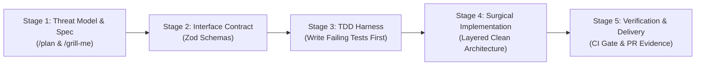
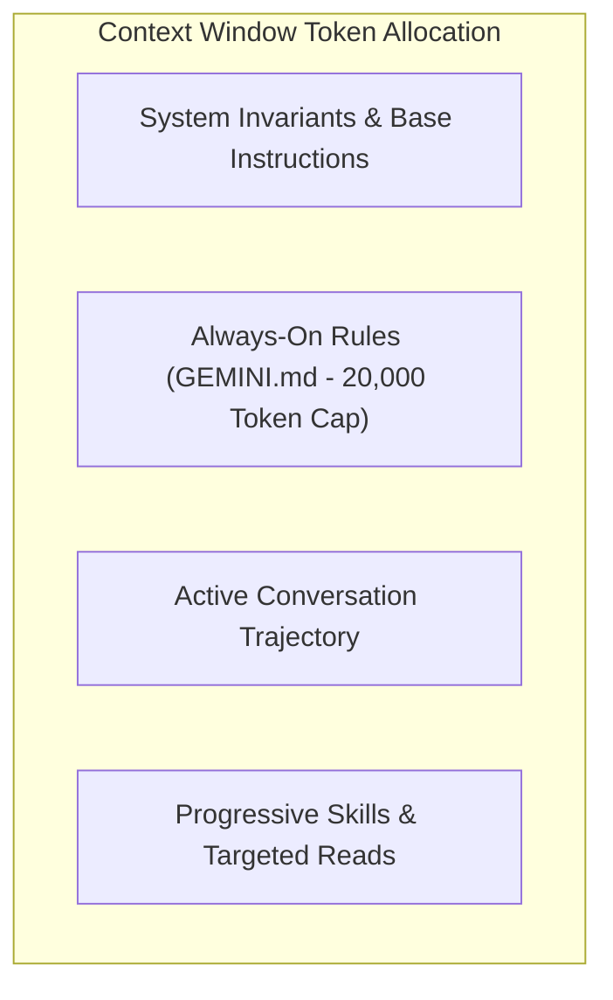
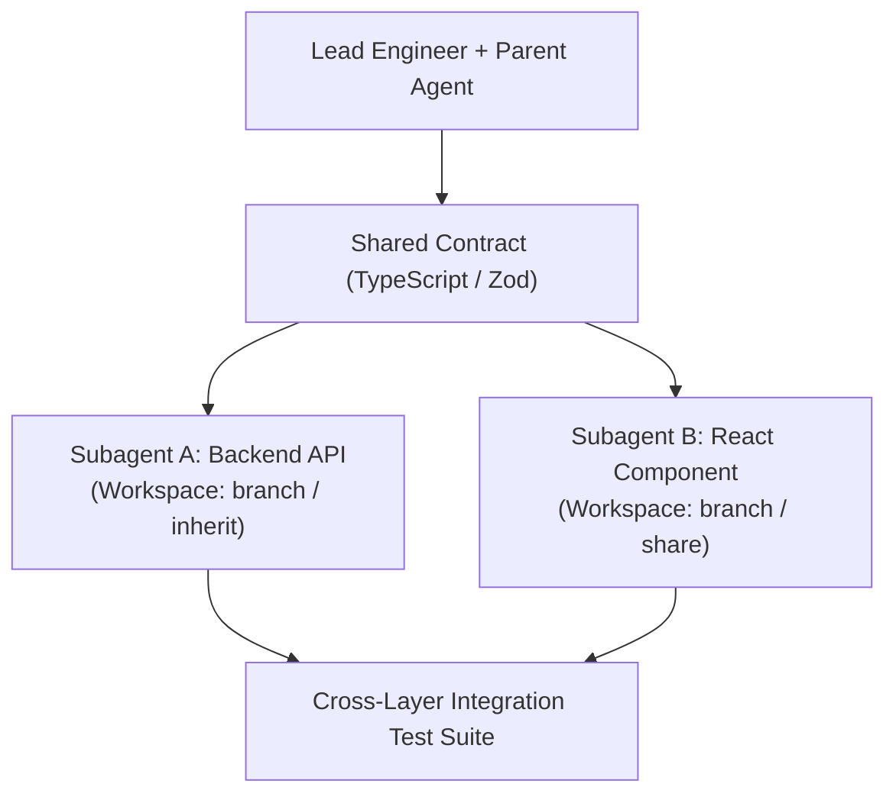

# Enterprise Antigravity Engineering Playbook
## The Professional Standard for AI-Assisted Software Engineering

> **Core Tenet**: Antigravity amplifies senior engineering judgment; it does not replace it. The engineer retains absolute accountability for system architecture, data integrity, authorization boundaries, and production correctness.

---

## Table of Contents
1. [Executive Summary & The Professional Paradigm](#1-executive-summary--the-professional-paradigm)
2. [The 5-Stage Professional Development Lifecycle (PDLC)](#2-the-5-stage-professional-development-lifecycle-pdlc)
3. [Context Window Economics & Anti-Rot Protocols](#3-context-window-economics--anti-rot-protocols)
4. [The 3-Tier Governance & Security Architecture](#4-the-3-tier-governance--security-architecture)
5. [Multi-Agent Orchestration & Task Decomposition](#5-multi-agent-orchestration--task-decomposition)
6. [Defending Against AI Hallucinations & Sub-Standard Code](#6-defending-against-ai-hallucinations--sub-standard-code)
7. [Team Onboarding & Repository Standardization](#7-team-onboarding--repository-standardization)
8. [Measuring Engineering Velocity & Quality KPIs](#8-measuring-engineering-velocity--quality-kpis)
9. [Daily Operational Cheat Sheet & Slash Command Map](#9-daily-operational-cheat-sheet--slash-command-map)

---

## 1. Executive Summary & The Professional Paradigm

The difference between a junior developer using AI for autocomplete and an elite software engineer using Antigravity lies in **deterministic control**:

```
NAIVE AI CODING (High Defect Rate, Frustration)
"Here is my repository, please add user payments and fix any bugs."
  └─ Result: Uncontrolled diffs, hallucinated libraries, broken schemas, context rot.

PROFESSIONAL AGENTIC ENGINEERING (Industry Standard)
Lead Architect (You) ──► Contract First (Zod/OpenAPI) ──► Strict Boundaries (GEMINI.md)
  └──► Subagent Delegation ──► Automated TDD Harness (Red->Green) ──► Verified Delivery
```

In the professional paradigm:
- The human acts as **Lead Architect & Security Reviewer**.
- Antigravity acts as a **High-Throughput Pair Programmer & Staff Engineer**.
- No code is committed without an automated test proving its correctness.

---

## 2. The 5-Stage Professional Development Lifecycle (PDLC)



### Stage 1: Problem Definition, Architecture & Threat Modeling
Before allowing the agent to touch source code, establish architectural alignment:
1. **Trigger `/plan`**: Ask the agent to break down the requirement into discrete, sequential steps, detailing every file to be created or modified.
2. **Trigger `/grill-me`**: Force the agent to interview you on edge cases, concurrency locks, data migration risks, and backward compatibility.
3. **Identify Threat Boundaries**: Identify potential timing attacks, unauthenticated routes, replay attacks, or untrusted client inputs.

### Stage 2: Contract-First Boundary Definition
Always lock down data contracts at the API boundary before writing services or database queries:
- Write strict schema validators using **Zod** (`.strict()`) to prevent prototype pollution or unrecognized payload fields.
- Export clean TypeScript / JSDoc interfaces from the schema.
- Define uniform RFC 7807 error responses for 400, 401, 403, 404, 409, and 422 errors.

### Stage 3: The Strict Test-Driven Development (TDD) Harness
The cardinal rule of professional AI assistance: **Never ask an agent to implement a feature or fix a bug without an automated test harness.**
- For bug fixes: Write the failing regression test first. Execute it and observe **RED**.
- For features: Write unit and integration test assertions matching the contract before generating the implementation.

### Stage 4: Surgical Layered Implementation
Enforce Clean Architecture separation across four layers:
1. **Routes**: Mount middleware and dispatch to controller methods. No business logic.
2. **Controllers**: Parse and validate HTTP inputs. Forward clean DTOs to services. Return standard HTTP status codes (200, 201, 202).
3. **Services**: Pure business domain logic. Never touch `req`, `res`, or `next`. Throw domain errors.
4. **Repositories**: Database queries, indexes, projections, and atomic transactions (`session.withTransaction`).

### Stage 5: Adversarial Review, CI Verification & Delivery
Run an adversarial red-team review on the resulting diff:
> *"Act as a Principal Security Engineer and Performance Architect. Red-team this diff for memory leaks, race conditions, unhandled promise rejections, or missing authorization checks."*
- Verify that `npm test` runs cleanly.
- Commit using atomic, conventional commit messages with test evidence included.

---

## 3. Context Window Economics & Anti-Rot Protocols

Context Rot is the degradation of reasoning caused by flooding the agent's context window with thousands of tokens of noisy build output, large JSON payloads, or entire vendor directories.



### The 4 Laws of Context Hygiene

1. **Law of Targeted Reads**:
   - Never run `read_file` on entire directories or monoliths.
   - Use `StartLine` and `EndLine` parameters to inspect only the 40–80 lines relevant to your immediate task.

2. **Law of Subagent Reconnaissance**:
   - When exploring unfamiliar codebases, never read 30 files into your main chat.
   - Dispatch a `research` subagent via `invoke_subagent`. It reads dozens of files in its own isolated context and returns a 10-line architectural summary, consuming zero context tokens in your primary session.

3. **Law of Progressive Disclosure**:
   - Keep [GEMINI.md](file:///home/prasanta/Documents/agy_learning_model/GEMINI.md) concise (under 20,000 tokens). Put critical invariants in `GEMINI.md`.
   - Move multi-step procedures (migrations, test runs, scaffolding) into **Skills** (`.agents/skills/`). Only the 1-line description of a skill is stored in active memory until invoked.

4. **Law of Compaction Cadence**:
   - When a conversation exceeds 30–40 turns or after a major refactor is complete, trigger `/compact` to summarize history and free token capacity.

---

## 4. The 3-Tier Governance & Security Architecture

In an enterprise setting, probabilistic instructions ("please don't delete files") are insufficient. You must combine probabilistic guidance with **deterministic runtime enforcement**:

```
┌────────────────────────────────────────────────────────┐
│ Tier 1: Deterministic Lifecycle Hooks (.agents/hooks)  │ -> Hard OS shell barriers (blocks destructive tools)
├────────────────────────────────────────────────────────┤
│ Tier 2: Progressive Skills (.agents/skills/*/SKILL.md) │ -> On-demand procedure runbooks (0 token bloat)
├────────────────────────────────────────────────────────┤
│ Tier 3: Hierarchical Ambient Rules (GEMINI.md)         │ -> Always-on architectural guidelines
└────────────────────────────────────────────────────────┘
```

### Tier 1: Deterministic Lifecycle Hooks (`hooks.json`)
Placed at `.agents/hooks.json`, these shell interceptors run synchronously at the OS level *before* any tool executes.
- **PreToolUse Gate**: Inspects the command line. If it contains forbidden operations (`rm -rf`, `git reset --hard`, `git push --force`, or reading `.env` credentials), the hook outputs `{"decision": "deny"}` and terminates execution before disk mutation can occur.

### Tier 2: Progressive Skills (`.agents/skills/`)
Modular runbooks stored in `.agents/skills/<name>/SKILL.md` with YAML frontmatter.
- Loaded on-demand when the prompt requires it (e.g., [`node-service-generator`](file:///home/prasanta/Documents/agy_learning_model/.agents/skills/node-service-generator/SKILL.md) or [`db-migration-runbook`](file:///home/prasanta/Documents/agy_learning_model/projects/production-toolkit/legacy-app/.agents/skills/db-migration-runbook/SKILL.md)).

### Tier 3: Ambient Rules (`GEMINI.md`)
Placed in repository roots and subdirectories. Loaded into context automatically, walking up from the current directory.
- Enforces coding styles, TypeScript standards, error formats, and transaction requirements.

### Model Context Protocol (MCP) Integration
- Connects Antigravity to local or remote database instances via `mcp_config.json`.
- Allows agents to introspect live MongoDB collections and schema indexes via stdio JSON-RPC 2.0 without exposing raw credentials in prompts.

---

## 5. Multi-Agent Orchestration & Task Decomposition

When delivering full-stack features, avoid having a single agent sequentially edit dozens of files across layers. Decompose tasks into parallel workstreams:



### Workspace Isolation Modes
- **`Workspace: 'inherit'`**: Subagent shares the parent workspace. Best for fast, localized, non-conflicting edits.
- **`Workspace: 'branch'`**: Subagent is cloned into an isolated workspace directory. Ideal for risky spikes or parallel feature implementations where code should not collide before review.
- **`Workspace: 'share'`**: Uses Git worktrees sharing `.git` objects. Ideal for subagents committing directly to separate feature branches.

### The Contract-First Decomposition Rule
Never dispatch parallel subagents without an agreed-upon, machine-validated contract (e.g., [`notification.contract.js`](file:///home/prasanta/Documents/agy_learning_model/labs/06-multi-agent-parallelism/contracts/notification.contract.js)). Both agents validate against this schema, guaranteeing zero integration mismatch upon merging.

---

## 6. Defending Against AI Hallucinations & Sub-Standard Code

AI models produce code that *looks* syntactically correct but frequently contains subtle production bugs. Below is your reference guide for identifying and eliminating these code smells:

| AI Code Smell | Real Production Impact | Defensive Solution |
|---|---|---|
| **Async in `.forEach()`** | `forEach` ignores promises. Functions return before DB writes settle; unhandled rejections crash process. | Use `for (const item of items)` or `await Promise.all(...)`. |
| **Price / Catalog Trust** | Agent trusts client-provided prices in `req.body` (`unitPrice: 0.01`). | Disallow client pricing with `.strict()` Zod schemas; look up canonical prices from database catalog. |
| **Missing ACID Transactions** | Writes to multiple collections fail halfway during an error, leaving orphaned data. | Require `session.withTransaction()` for multi-document mutations. |
| **Timing Side-Channels** | Using `===` to compare cryptographic HMAC signatures allows timing analysis. | Use `crypto.timingSafeEqual(bufA, bufB)`. |
| **Replay Attack Vulnerability** | Webhook endpoints accept requests without verifying timestamp skew. | Reject requests where `Math.abs(now - timestamp) > 300` seconds. |
| **Zombie Test Handles** | Forgetting to close HTTP servers or database connections, hanging CI jobs. | Always close server instances in `after()` lifecycle hooks. |

---

## 7. Team Onboarding & Repository Standardization

To transform an existing team repository into an enterprise-grade Antigravity environment, use our automated scaffolding utility:

```bash
node /home/prasanta/Documents/agy_learning_model/projects/production-toolkit/init-antigravity.mjs /path/to/target-repo
```

### What This Automates:
1. Installs root [GEMINI.md](file:///home/prasanta/Documents/agy_learning_model/GEMINI.md) with backend clean architecture and security standards.
2. Creates `.agents/hooks.json` and [pre-tool-safety.js](file:///home/prasanta/Documents/agy_learning_model/projects/production-toolkit/legacy-app/.agents/scripts/pre-tool-safety.js) blocking `rm -rf`, `git push --force`, and credential leaks (`.env`).
3. Installs the zero-downtime database migration skill (`db-migration-runbook`).
4. Establishes the standard CI/CD workflow in `.github/workflows/verify.yml`.

---

## 8. Measuring Engineering Velocity & Quality KPIs

To ensure AI integration genuinely accelerates engineering rather than creating technical debt, track these four key performance metrics:

| Metric | Pre-AI Baseline | Antigravity Target | Measurement Method |
|---|---|---|---|
| **Cycle Time (PR to Production)** | 2–4 days | < 4 hours | Timestamp from initial task specification to green CI and merge. |
| **Defect Escape Rate** | ~8–12% post-merge bugs | < 2% | Production incidents vs bugs caught by TDD regression suites. |
| **Test Coverage Delta** | Spotty / skipped under time pressure | 100% on domain & boundary layers | Route, controller, and service coverage measured in CI. |
| **Rework Ratio** | High (multiple PR review rounds on style/architecture) | Near Zero | Number of review rounds needed to fix architectural inconsistencies (prevented by `GEMINI.md`). |

---

## 9. Daily Operational Cheat Sheet & Slash Command Map

### Slash Commands Reference
- **/plan**: Generate an architectural step-by-step breakdown before writing code.
- **/grill-me**: Stress-test your design decisions through an interactive interview.
- **/goal**: Execute long-running overnight or multi-hour autonomous tasks without manual prompts.
- **/compact**: Free up token capacity when conversation context grows large.
- **/learn**: Persist corrections or domain patterns discovered during coding.
- **/boost**: Activate deep multi-perspective reasoning for complex concurrency or algorithmic problems.

### Daily Verification Command
Run the complete automated test suite across all modules and safety gates:
```bash
npm test
```
