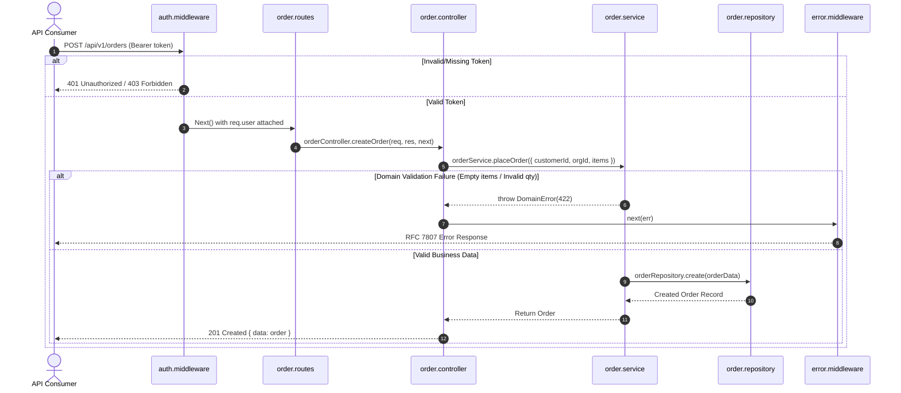

# Codebase Architectural Audit: Sample Order Monolith

## 1. Architectural Pattern: Clean Layered Architecture

The inspected service in [`sample-monolith/`](file:///home/prasanta/Documents/agy_learning_model/labs/03-codebase-exploration/sample-monolith/) adheres to a 4-tier layered model:

---

## 2. Multi-Tenant Security & Tenant Isolation

- **Mechanism**: The [`auth.middleware.js`](file:///home/prasanta/Documents/agy_learning_model/labs/03-codebase-exploration/sample-monolith/src/middleware/auth.middleware.js) extracts the customer ID and tenant `organizationId` directly from the validated Bearer token.
- **Tenant Scoping**: All database reads in [`order.repository.js`](file:///home/prasanta/Documents/agy_learning_model/labs/03-codebase-exploration/sample-monolith/src/repositories/order.repository.js#L18-L30) enforce `order.organizationId === organizationId` to prevent cross-tenant data leakage.

---

## 3. Critical Architectural Flaws & `GEMINI.md` Violations

Our audit discovered **three major vulnerabilities**:

| # | Flaw / Violation | Location | Impact | Fix Required |
|---|---|---|---|---|
| 1 | **Missing Boundary Validation** | [`order.routes.js`](file:///home/prasanta/Documents/agy_learning_model/labs/03-codebase-exploration/sample-monolith/src/routes/order.routes.js) | Arbitrary JSON types can be injected into the request body without schema validation. | Implement Zod schema middleware on the route boundary. |
| 2 | **Price Trust Vulnerability** | [`order.service.js`](file:///home/prasanta/Documents/agy_learning_model/labs/03-codebase-exploration/sample-monolith/src/services/order.service.js#L22-L29) | The service calculates the order total using `item.unitPrice` supplied by the client. A malicious user can send `unitPrice: 0.01`. | Look up canonical prices from an inventory/product repository. |
| 3 | **Missing ACID Transaction** | [`order.repository.js`](file:///home/prasanta/Documents/agy_learning_model/labs/03-codebase-exploration/sample-monolith/src/repositories/order.repository.js#L6-L16) | `create()` accepts `session = null` but never enforces `session.withTransaction()`, violating multi-document ACID rules in [GEMINI.md](file:///home/prasanta/Documents/agy_learning_model/GEMINI.md). | Wrap order creation and inventory decrement in an atomic transaction session. |
