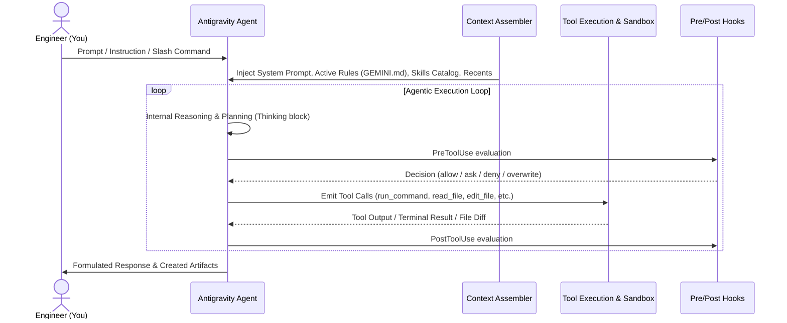

# Module 1: Antigravity Mental Models, Context Economics & Environment Configuration

## 1. The Core Mental Model: The Agent Execution Loop

Traditional code autocomplete tools (like Copilot inline completions) operate on simple token prediction. Antigravity operates on an **Agentic Feedback Loop**:



### Key Stages
1. **Context Assembly**: Before the model generates a single token, Antigravity gathers project rules (`GEMINI.md` / `AGENTS.md`), catalog descriptions of available skills, file mentions (`@file`), and conversation history.
2. **Internal Chain-of-Thought (Thinking)**: The model develops an execution plan, identifies unknowns, and determines which tool to invoke.
3. **Tool Invocations**: The agent makes discrete, structured tool calls (`run_command`, `read_file`, `write_file`, `edit_file`, `search_web`, `invoke_subagent`).
4. **Reactive Wakeup**: When async or background tasks are spawned, you do not need to poll. The system reactively wakes up the agent when output arrives.
5. **Human Inspection & Verification**: You inspect the changes and verify execution.

---

## 2. Context Window Economics & Context Rot

One of the most common pitfalls of AI-assisted engineering is **Context Rot**—filling the context window with megabytes of noisy build logs, large JSON payloads, or entire vendor directories.

### Rules of Context Hygiene
- **Progressive Disclosure**: Never read entire codebases at once. Use search, directory trees, and specific line ranges (`read_file` with `StartLine` and `EndLine`).
- **Offload Heavy Research**: Use the `research` subagent. The subagent can read 50 files, analyze patterns, and return a 10-line architectural summary, keeping your main context pristine.
- **Rule Limits**: Always-on rules (`GEMINI.md`) share a dedicated **20,000 token budget**. Keep rules concise, high-signal, and directive.

---

## 3. Tool Execution Policies & Sandboxing

Antigravity gives you strict control over what commands and tools can run on your system:

| Policy | Behavior | Best Used For |
|---|---|---|
| `strict` | Every single command and tool call requires manual human approval. | High-security repos or unfamiliar scripts. |
| `request-review` | Dangerous commands (e.g. file deletion, git resets, network calls) prompt for review; benign commands proceed. | Balanced everyday engineering. |
| `proceed-in-sandbox` | Commands run inside an isolated Linux sandbox container. | Running tests or untrusted dependencies without host risk. |
| `always-proceed` | Commands execute autonomously without prompting. | Long-running automated background tasks (`/goal`). |

---

## 4. Hands-on Lab 1.1: Tracing the Loop

In this lab, you will inspect how Antigravity communicates, executes tools, and manages state.

1. **Locate your conversation transcript**:
   - Transcripts are recorded at `~/.gemini/antigravity-cli/brain/<conversation-id>/.system_generated/logs/transcript.jsonl`.
2. **Observe step structures**:
   - Open terminal and examine a recent step:
     ```bash
     tail -n 2 ~/.gemini/antigravity-cli/brain/*/ .system_generated/logs/transcript.jsonl | jq .
     ```
   - Notice the fields: `step_index`, `type`, `thinking`, `tool_calls`, and `content`.
3. **Practice Slash Commands**:
   - `/plan`: Request a step-by-step breakdown before writing code.
   - `/grill-me`: Interactive technical interview to test architectural assumptions.
   - `/compact`: Free up token window when sessions become long.
