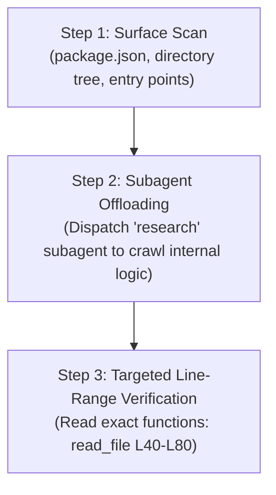

# Module 3: Codebase Exploration & Architectural Reverse-Engineering

## 1. The Engineering Challenge: Context Bloat in Codebases

When joining a new team or tackling a legacy repository, engineers often prompt AI assistants with:
> *"Here is my entire repository. Explain how authentication and checkout work."*

### Why this fails:
1. **Token Exhaustion**: Dumping 50 source files consumes 80,000+ tokens in one turn.
2. **Context Degradation**: The model loses track of nuanced project rules and makes vague, generalized observations.
3. **High Cost & High Latency**: Every subsequent turn re-processes that bloated context.

---

## 2. The 3-Step Reconnaissance Protocol

Elite AI-assisted engineers use a structured, high-signal exploration protocol:



### Step 1: Surface Scan
- Inspect `package.json` for frameworks, libraries, database drivers, and scripts.
- List directories to identify architecture patterns (e.g., MVC vs Clean Architecture vs Hexagonal).
- Read the main entry point (`server.js`, `app.ts`) to locate router mounts and middleware.

### Step 2: The `research` Subagent Pattern
Antigravity provides a specialized **`research` subagent** equipped with read-only exploration tools.
- It operates in its own isolated context.
- It can read 20+ files, inspect dependencies, and grep code without adding a single token of junk to your main conversation.
- When finished, it messages you back with a concise architectural brief.

### Step 3: Targeted Line-Range Verification
Once the subagent locates the critical functions, you use targeted file reads:
```
read_file(Path: ".../order.service.js", StartLine: 45, EndLine: 90)
```
This keeps your context lean, sharp, and focused on implementation.
