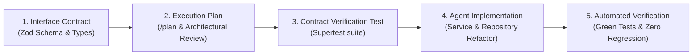

# Module 4: Spec-Driven Feature Development & Production Refactoring

## 1. Why Spec-Driven Development Matters with AI

The most common failure mode in AI coding is **Architectural Drift**:
1. You ask an AI to "Add input validation and fix order pricing."
2. Without a spec, the AI changes function signatures, rewrites database schemas, or changes error codes unpredictably.
3. Your frontend or integration tests immediately break.

### The Spec-Driven Workflow:


---

## 2. Using Antigravity Slash Commands for Architectural Alignment

Before writing a single line of production code, use these built-in slash commands:

- **/plan**: Prompts Antigravity to generate a granular step-by-step implementation plan, listing all files to be modified, created, or tested, without touching your codebase.
- **/grill-me**: Initiates an adversarial interview where Antigravity asks *you* probing questions about edge cases, concurrency locks, backward compatibility, and error codes.
- **/boost**: Activates multi-perspective reasoning for complex architectural refactoring.

---

## 3. The 4 Golden Rules of Production Node.js Refactoring with AI

1. **Lock Down the Contract First**: Write the Zod schema and export TypeScript/JSDoc types before asking the agent to touch controller or service code.
2. **Never Trust Client Pricing or Identifiers**: Always pull tenant IDs from verified session/tokens (`req.user`), and fetch prices from authoritative database collections.
3. **Strict ACID Boundaries**: Any operation touching more than one document or collection must use an explicit session:
   ```javascript
   await session.withTransaction(async () => {
     await inventoryRepo.decrementStock(sku, quantity, { session });
     await orderRepo.create(orderData, { session });
   });
   ```
4. **Preserve Error Formatting**: All validation failures must return uniform RFC 7807 problem details so API clients never encounter unexpected JSON formats.
