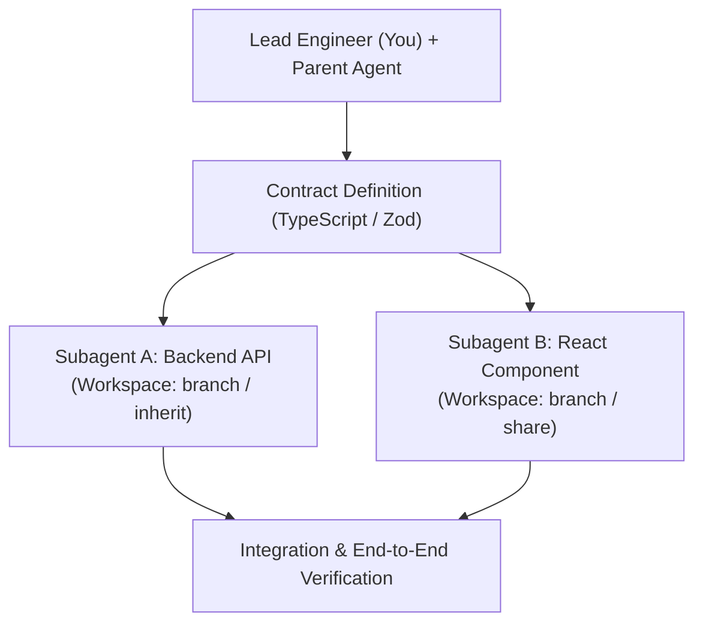

# Module 6: Multi-Agent Parallelism & Safe Task Decomposition

## 1. The Multi-Agent Mental Model

When dealing with large full-stack features, having a single agent sequentially edit 15 files across backend, frontend, and database models leads to:
1. Long serial wait times.
2. Context window saturation.
3. Higher probability of cross-layer hallucinations.

In Antigravity, you can decompose a task into **specialized, parallel subagents**:

---

## 2. Workspace Isolation Modes

When invoking subagents with `invoke_subagent`, the `Workspace` parameter governs disk isolation:

| Workspace Mode | Mechanism | Best Used For |
|---|---|---|
| **`inherit`** | Subagent writes directly to your current project directory. | Fast, localized edits where files do not overlap. |
| **`branch`** | Clones/branches the repository into an isolated sandbox directory. | Experimental features, risky spikes, or completely independent modules. |
| **`share`** | Uses Git worktrees (`git worktree` / `hg share`) sharing git objects. | Parallel feature development where subagent commits to a feature branch without disk bloat. |

---

## 3. The Contract-First Decomposition Rule

**Never dispatch parallel agents without a rigid, agreed-upon contract.**

If you dispatch Agent A to write the API and Agent B to write the React frontend without a contract:
- Agent A might return `{ data: { items: [...] } }`.
- Agent B might expect `{ notifications: [...] }`.
- Integration fails, requiring manual rework.

### The Protocol:
1. Define the shared contract in `contracts/<feature>.contract.js`.
2. Provide the exact contract path to both agents.
3. Validate both implementations against the contract using automated tests.
