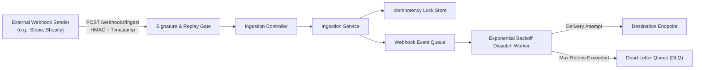

# Architectural Specification: Enterprise Webhook Ingestion & Resilient Dispatch Engine

## 1. System Overview

The Webhook Engine is a multi-tenant event ingestion and dispatch platform designed to process high-throughput external webhooks safely and deliver outbound event notifications with fault tolerance.

---

## 2. Threat Modeling & Defensive Boundaries

1. **Payload Tampering**:
   - Every payload must be signed with HMAC-SHA256 using a shared secret.
   - Header: `X-Signature-SHA256` computed as `hex(HMAC-SHA256(secret, timestamp + "." + rawBody))`.
   - Timing-safe comparison using `crypto.timingSafeEqual` prevents timing attacks.

2. **Replay Attacks**:
   - Header: `X-Webhook-Timestamp`.
   - Any request with a timestamp older than 300 seconds (5 minutes) or skewed into the future (> 60 seconds) is rejected with 400 Bad Request.

3. **Duplicate Delivery / Concurrency Race**:
   - Header: `X-Idempotency-Key` (or payload `eventId`).
   - Atomic check-and-set in idempotency store. If the key exists, return 409 Conflict (or 200 with cached response).

4. **Transient Outage at Destination**:
   - Exponential backoff with jitter (initial backoff: 50ms, multiplier: 2, max retries: 3).
   - If 3 attempts fail, status transitions from `RETRYING` to `DEAD_LETTER`.

---

## 3. Data Schema & Contracts

### Ingestion Contract
- **Headers**:
  - `X-Signature-SHA256`: string (hex HMAC)
  - `X-Webhook-Timestamp`: string / number (Unix timestamp in seconds)
  - `X-Tenant-Id`: string
- **Body**:
  - `eventId`: string (uuid / unique identifier)
  - `eventType`: string (e.g. `payment.completed`, `user.created`)
  - `payload`: record / object
  - `destinationUrl`: string (valid url)
